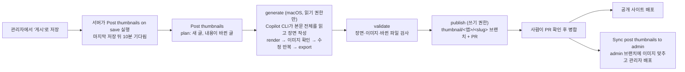

# 게시글 썸네일 (UI 미니어처) 도구

Elevate 블로그(microsoft-elevate.com) 카드 썸네일을 그리는 키트와, 새 게시글·내용이 바뀐 게시글의 썸네일을 AI가 만들어 PR로 올리는 파이프라인입니다.
공개 사이트와 관리자 목록은 `Elevate.Web/src/assets/post-thumbs/<앱>/<slug>-960.webp`, `-480.webp`를 DB 썸네일보다 먼저 씁니다.

## 흐름



0. **시작** (`post-thumbnails-on-save.yml`): 관리자에서 글을 '게시' 상태로 저장(새 글·수정)하면 서버(`Elevate.Server/src/services/thumbnailTrigger.js`)가
   이 workflow를 실행합니다. 마지막 저장 뒤 10분(저장소 변수 `THUMBNAIL_WAIT_MINUTES`) 동안 다시 저장이 없으면 `Post thumbnails`를 실행하고,
   그 사이 다시 저장하면 기다리던 실행은 취소됩니다. 그래서 고쳐 쓰며 여러 번 저장해도 AI 작업은 한 번입니다.
   정기 실행은 없으므로 글이 없는 동안에는 아무것도 돌지 않습니다. 수동 실행(Run workflow)은 언제든 됩니다.
1. **plan** (`plan.mjs`): 공개 API에서 13개 앱의 게시된 글을 읽어 다음 글을 한 번에 2개까지 고릅니다(새 글 먼저, 각각 최신 게시순).
   앱·주소는 공개 사이트와 같은 규칙(`Elevate.Web/src/constants/categories.js`)으로 정합니다.
   - **새 글**: 공개 사이트 이미지가 없는 글.
   - **내용이 바뀐 글**: 이미지를 그린 글 버전(`sources/<앱>/<slug>.json`의 지문)과 지금 글의 지문이 다른 글.
     지문은 공개 사이트에 보이는 제목·요약과 본문 전체 글자(이미지 대체 텍스트 포함)의 SHA-256입니다.
     게시 상태 변경이나 내용 없는 저장은 지문을 바꾸지 않습니다. 수정 시각이 기록과 같으면 본문을 받지 않고,
     다르면 본문을 받아 지문을 계산해 `.cache/hashes.json`(Actions 캐시)에 남깁니다.
   - 같은 내용으로 이미 만든 PR 브랜치(`thumbnail/<앱>/<slug>`)가 있거나(검토 중·닫음), 열린 실패 이슈가 있으면 건너뜁니다.
2. **generate** (macOS 러너): `prepare.mjs`가 글 본문 전체를 `work/<앱>__<slug>/post.md`로 쓰고 `TASK.md`로 작업 지시를 만듭니다.
   내용이 바뀐 글은 지금 이미지(`previous-960.webp`)와 이전 장면을 함께 줍니다.
   GitHub Copilot CLI가 `STYLE_GUIDE.md`·같은 앱의 기존 장면·본문을 읽고 `scenes/auto/<앱>/<slug>.js`를 쓴 뒤,
   렌더러로 그려(`zoom`·`review`) 이미지를 직접 보며 다듬고 `export`합니다. 이 job의 토큰은 저장소 읽기와 Copilot 요청만 할 수 있습니다.
   Copilot이 실행할 수 있는 명령은 렌더러뿐이고(workflow가 `node render.mjs`를 `thumb-render`라는 이름으로 PATH에 둡니다),
   파일은 그 글의 장면과 `work/<앱>__<slug>/summary.md`만 만들고 고칠 수 있습니다(셸 리디렉션도 막힘).
   Copilot CLI는 `git`·`gh` 밖의 명령을 이름으로만 구분하므로 `shell(node render.mjs:*)` 같은 규칙은 맞지 않고,
   쓰기 규칙은 실제 경로(`pwd -P`)로 적어야 합니다.
3. **validate** (`validate.mjs`): 장면이 그 글 하나만 등록하는지, 네트워크·외부 URL 코드가 없는지 확인하고 다시 그려 audit 경고 0을 확인합니다.
   WebP 크기(960×540, 480×270)를 보고, 통과하면 글 버전 기록(`sources/<앱>/<slug>.json`)을 저장합니다.
   저장소에서 바뀐 파일이 장면·버전 기록·이미지 2장뿐인지도 봅니다.
4. **publish** (`publish.mjs`): 결과를 다시 검사해 브랜치에 커밋하고 PR(라벨 `thumbnail`)을 엽니다. PR 본문에 썸네일 미리보기, 글 주소,
   AI 설명(`summary.md`)이 들어가고, 내용이 바뀐 글은 지금 이미지와 새 이미지를 나란히 보여 줍니다(PR 제목 '썸네일 새 버전'). 결과가 없으면 `썸네일 자동 생성 실패: <key>` 이슈(라벨 `thumbnail-failed`)를 남깁니다.
5. PR을 병합하면 공개 사이트(GitHub Pages)가 배포되고, `Sync post thumbnails to admin`이 `admin` 브랜치에 이미지 폴더만 맞춘 뒤 관리자를 배포합니다.

새 글은 PR이 병합되기 전까지 카드에 앱 유리 타일(또는 예전 DB 썸네일)이 보이고, 내용이 바뀐 글은 병합 전까지 지금 이미지가 그대로 보입니다.
사람이 만든 기존 80개 썸네일에도 지금 내용으로 버전 기록을 만들어 두었으므로(`node baseline.mjs`), 그 글들의 내용이 바뀌어도 새 버전을 만듭니다.

## 운영

| 할 일 | 방법 |
| --- | --- |
| 새 썸네일 확인 | PR(라벨 `thumbnail`) 본문의 이미지를 보고 병합합니다. 병합 후 몇 분 안에 두 사이트에 반영됩니다 |
| 다시 만들기 | Actions → **Post thumbnails** → Run workflow에 `key`(예: `m365/test`)와 `feedback`(바라는 점)을 넣어 실행합니다. 열린 PR이 있으면 그 PR이 새 이미지로 바뀝니다 |
| 쓰지 않기 | PR을 닫습니다. 같은 내용으로는 자동으로 다시 만들지 않고, 글이 다시 바뀌면 그때 새로 만듭니다(브랜치 `thumbnail/<앱>/<slug>`를 지우면 다음 실행 때 다시 만듭니다) |
| 실패했을 때 | `thumbnail-failed` 이슈와 실행의 `log-<앱>__<slug>` 아티팩트(Copilot 작업 기록 `transcript.md`, 렌더 이미지)를 봅니다. 이슈를 닫으면 다음 실행 때 다시 시도합니다 |
| 모델 바꾸기 | 기본은 Claude Opus 5.5(`claude-opus-5.5`)입니다. 저장소 변수 `THUMBNAIL_MODEL`(Settings → Secrets and variables → Actions → Variables)에 다른 모델 이름을 넣으면 그 모델을 씁니다 |
| 기다리는 시간 바꾸기 | 저장소 변수 `THUMBNAIL_WAIT_MINUTES`(분, 0~60, 기본 10)를 바꿉니다. 짧을수록 빨리 시작하지만, 그 안에 다시 저장하면 AI 작업을 한 번 더 할 수 있습니다 |
| 잠시 멈추기 | Actions → **Post thumbnails on save** → ··· → Disable workflow(저장해도 시작하지 않음). 수동 실행은 그대로 됩니다 |

### 필요한 설정

- **Settings → Actions → General → Workflow permissions → "Allow GitHub Actions to create and approve pull requests"** 를 켜야 PR을 만들 수 있습니다.
  꺼져 있으면 publish가 브랜치까지만 올리고 실패 이슈에 PR 만들기 링크를 남깁니다.
- **서버 토큰** (저장할 때 시작하려면 필요): 서버가 GitHub에 실행을 요청할 때 쓰는 fine-grained personal access token입니다.
  1. GitHub → Settings → Developer settings → Personal access tokens → Fine-grained tokens → Generate new token
  2. Resource owner `oneot`, Repository access는 "Only select repositories"로 `oneot/elevate` 하나만 고릅니다.
  3. Repository permissions에서 **Actions: Read and write**만 줍니다(Metadata 읽기는 자동). 코드·PR·비밀값은 바꿀 수 없는 권한입니다.
  4. 만료일을 정하고(예: 1년), 만료 전에 새 토큰으로 바꿉니다.
  5. Function App(`func-elv-server-ep-dev`) 앱 설정 `THUMBNAIL_DISPATCH_TOKEN`에 넣습니다. 코드·저장소·문서에는 적지 않습니다.

  토큰이 없거나 만료되면 저장은 그대로 되고 썸네일 작업만 시작하지 않습니다(Function App 로그에 `[thumbnailTrigger]` 경고, 그동안은 수동 실행).
  선택 설정: `THUMBNAIL_DISPATCH_REPOSITORY`(기본 `oneot/elevate`), `THUMBNAIL_DISPATCH_WORKFLOW`(기본 `post-thumbnails-on-save.yml`),
  `THUMBNAIL_DISPATCH_REF`(기본 `main`).
- Actions 쪽 비밀값은 필요 없습니다. Copilot CLI는 `GITHUB_TOKEN`(`copilot-requests: write`)으로 인증하며,
  개인 소유 저장소이므로 사용량은 저장소 소유자(oneot)의 Copilot 이용량에서 차감됩니다.
- Actions 분 사용량: 공개 저장소의 GitHub 호스트 러너는 무료입니다(macOS 포함). 저장 한 번에 대기 job(기본 10분)과 plan(약 30초)이 돌고,
  새 글·내용 변경이 없으면 AI를 부르지 않습니다.

### 보안

- 서버의 실행 요청(workflow_dispatch)과 수동 실행만 받습니다(pull request로는 실행되지 않음).
- 글 본문은 관리자(Entra 로그인)만 쓸 수 있고, 생성 job의 토큰은 읽기 전용입니다. 결과 파일은 별도 job이 다시 검사한 뒤에만 커밋합니다.
- 장면 코드는 렌더할 때만 이 도구의 브라우저에서 실행되고, 공개 사이트에는 이미지(WebP)만 들어갑니다.

## 로컬에서 쓰기

Node 22, macOS 기준입니다.

```bash
cd tools/post-thumbs
npm ci
npx playwright install chromium        # 또는 설치된 Edge를 쓰려면 THUMB_BROWSER_CHANNEL=msedge
node data.mjs                          # 공개 글 목록 → data/posts.json
node render.mjs review word            # review/word.png
node render.mjs zoom word/wordonline1  # review/zoom_word__wordonline1.png
node render.mjs export --cat word      # 공개 사이트 이미지 다시 쓰기
node plan.mjs                          # 지금 만들 글 목록 (새 글, 내용이 바뀐 글)
node baseline.mjs                      # 이미지는 있는데 버전 기록이 없는 글에 지금 내용으로 기록 만들기
node prepare.mjs m365/test             # work/m365__test/post.md, task.md
node validate.mjs m365/test --no-git-check
npm test                               # 단위 테스트 (브라우저·네트워크 없음)
```

`render.mjs`는 이전 `render.py`와 같은 결과를 냅니다(기존 80개를 다시 그렸을 때 평균 픽셀 차 0.5/255 이하, WebP 압축 차이).
장면 작성 규칙은 [STYLE_GUIDE.md](STYLE_GUIDE.md), AI 작업 지시는 [TASK.md](TASK.md)에 있습니다.
지문 계산(`lib/posts.mjs`의 `contentHash`, `htmlToOutline`)을 바꾸면 기존 기록과 비교가 맞지 않으므로 `sources/`를 지우고 `node baseline.mjs`로 다시 만듭니다
(지금 이미지가 있는 글만 기록하므로, AI가 만든 글도 그 시점 내용 기준으로 다시 기록됩니다).
