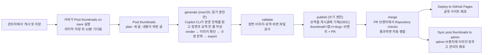

# 게시글 썸네일 (UI 미니어처)·요약 도구

Elevate 블로그(microsoft-elevate.com) 카드 썸네일을 그리는 키트와, 새 게시글·내용이 바뀐 게시글의 썸네일과 요약 한 줄을 AI가 만들어
요약은 게시글에 바로 기재하고, 썸네일은 PR로 올려 검사를 통과하면 사람 없이 병합·배포하는 파이프라인입니다.
공개 사이트와 관리자 목록은 `Elevate.Web/src/assets/post-thumbs/<앱>/<slug>-960.webp`, `-480.webp`를 DB 썸네일보다 먼저 씁니다.
관리자에는 요약 입력 칸이 없습니다. 게시글의 요약(`excerpt`)은 이 파이프라인의 AI가 기재합니다.
새 썸네일은 **v3 플루이드** 스킨으로 그립니다(아래 '디자인'). 먼저 공개된 80개 썸네일은 v2 이미지 그대로 둡니다.

## 흐름



0. **시작** (`post-thumbnails-on-save.yml`): 관리자에서 글을 '게시' 상태로 저장(새 글·수정)하면 서버(`Elevate.Server/src/services/thumbnailTrigger.js`)가
   이 workflow를 실행합니다. 마지막 저장 뒤 10분(저장소 변수 `THUMBNAIL_WAIT_MINUTES`) 동안 다시 저장이 없으면 `Post thumbnails`를 실행하고,
   그 사이 다시 저장하면 기다리던 실행은 취소됩니다. 그래서 고쳐 쓰며 여러 번 저장해도 AI 작업은 한 번입니다.
   정기 실행은 없으므로 글이 없는 동안에는 아무것도 돌지 않습니다. 수동 실행(Run workflow)은 언제든 됩니다.
1. **plan** (`plan.mjs`): 공개 API에서 13개 앱의 게시된 글을 읽어 다음 글을 한 번에 2개까지 고릅니다(새 글 먼저, 각각 최신 게시순).
   앱·주소는 공개 사이트와 같은 규칙(`Elevate.Web/src/constants/categories.js`)으로 정합니다.
   - **새 글**: 공개 사이트 이미지가 없는 글.
   - **내용이 바뀐 글**: 이미지를 그린 글 버전(`sources/<앱>/<slug>.json`의 지문)과 지금 글의 지문이 다른 글.
     지문은 공개 사이트에 보이는 제목·요약과 본문 전체 글자(이미지 대체 텍스트 포함)의 SHA-256입니다.
     게시 상태 변경이나 내용 없는 저장은 지문을 바꾸지 않습니다. 수정 시각이 기록과 같으면 본문을 받지 않고,
     다르면 본문을 받아 지문을 계산해 `.cache/hashes.json`(Actions 캐시)에 남깁니다.
     AI 요약 기재는 수정 시각을 바꾸지 않으므로, 캐시는 수정 시각과 화면 제목·요약이 모두 같을 때만 다시 씁니다(`hashCacheHit`).
   - 같은 내용으로 이미 만든 PR 브랜치(`thumbnail/<앱>/<slug>`)가 있거나(검토 중·병합 보류·닫음), 열린 실패 이슈가 있으면 건너뜁니다.
     브랜치를 만든 뒤 글을 다시 저장하지 않았으면(브랜치 기록의 수정 시각이 같으면) 요약 기재에 실패해 지문이 달라도 같은 내용으로 봅니다.
     병합한 썸네일은 main의 버전 기록으로 같은 내용을 알아보므로, 병합 뒤 브랜치를 지워도 다시 만들지 않습니다.
2. **generate** (macOS 러너): `prepare.mjs`가 글 본문 전체를 `work/<앱>__<slug>/post.md`로 쓰고 `TASK.md`로 작업 지시를 만듭니다.
   내용이 바뀐 글은 지금 이미지(`previous-960.webp`)와 이전 장면을 함께 줍니다.
   GitHub Copilot CLI가 `STYLE_GUIDE.md`(v3 규칙)·같은 앱의 기존 장면·본문을 읽고 `scenes/auto/<앱>/<slug>.js`를 쓴 뒤,
   렌더러로 그려(`zoom`의 960px·실제 카드 480px, `review`) 이미지를 직접 보며 다듬고 `export`합니다. 이 job의 토큰은 저장소 읽기와 Copilot 요청만 할 수 있습니다.
   같은 세션에서 요약 한 줄(`work/<앱>__<slug>/excerpt.txt`)도 씁니다. 사람이 다듬은 기존 요약 80개(33~55자, 모두 '~니다.')에 맞춰
   35~55자 한 문장으로, 이 글로 무엇을 만들고 익히는지 씁니다. 작업 지시에 같은 앱의 요약 예시를 넣고(`pickExcerptExamples`),
   AI는 `thumb-render excerpt <key>`로 규칙(`checkExcerpt`)을 스스로 확인합니다. 본문을 한 번 읽어 둘 다 만들므로 요약에 드는 AI 이용량은 거의 없습니다.
   Copilot이 실행할 수 있는 명령은 렌더러뿐이고(workflow가 `node render.mjs`를 `thumb-render`라는 이름으로 PATH에 둡니다),
   파일은 그 글의 장면과 `work/<앱>__<slug>/summary.md`·`excerpt.txt`만 만들고 고칠 수 있습니다(셸 리디렉션도 막힘).
   Copilot CLI는 `git`·`gh` 밖의 명령을 이름으로만 구분하므로 `shell(node render.mjs:*)` 같은 규칙은 맞지 않고,
   쓰기 규칙은 실제 경로(`pwd -P`)로 적어야 합니다.
3. **validate** (`validate.mjs`): 장면이 그 글 하나만 등록하는지, 네트워크·외부 URL 코드가 없는지 확인하고 다시 그려 audit 경고 0을 확인합니다.
   WebP 크기(960×540, 480×270)를 보고, 통과하면 글 버전 기록(`sources/<앱>/<slug>.json`)을 저장합니다.
   요약이 규칙에 맞으면 기록에 `excerpt`로 남기고, 지문을 **AI 요약이 공개 사이트에 보이는 문구로**(덮어쓰기 표 `postText.js` 규칙 포함, `hashWithExcerpt`) 다시 계산합니다. 요약이 게시글에 기재된 뒤의 글과 지문이 같아야
   같은 내용으로 다시 만들지 않기 때문입니다. 요약이 없거나 규칙에 맞지 않으면 썸네일은 그대로 두고 요약만 기재하지 않습니다(경고).
   저장소에서 바뀐 파일이 장면·버전 기록·이미지 2장뿐인지도 봅니다.
4. **publish** (`publish.mjs`): 먼저 요약을 게시글에 기재합니다(`lib/excerpt.mjs` → 서버 `PUT /api/automation/posts/{id}/excerpt`).
   비밀값 없이 GitHub OIDC 토큰으로 인증하며(job 권한 `id-token: write`), 서버는 AI가 읽은 뒤 바뀌지 않은 게시 글에만 쓰고 수정 시각은 바꾸지 않습니다.
   그 사이 글이 저장됐으면(409) 건너뛰고 다음 실행이 다시 만듭니다. 서버 오류는 10초 간격으로 다시 시도하고, 실패해도 썸네일 PR은 엽니다.
   기재하지 못한 요약은 그 글을 다음에 저장할 때 다시 만듭니다(기록의 지문은 AI 요약 기준이라 지금 글과 달라짐).
   이어서 결과를 다시 검사해 브랜치에 커밋하고 PR(라벨 `thumbnail`)을 엽니다. PR 본문에 썸네일 미리보기, 글 주소, 요약(AI)과 기재 결과,
   AI 설명(`summary.md`)이 들어가고, 내용이 바뀐 글은 지금 이미지와 새 이미지를 나란히 보여 줍니다(PR 제목 '썸네일 새 버전'). 결과가 없으면 `썸네일 자동 생성 실패: <key>` 이슈(라벨 `thumbnail-failed`)를 남깁니다.
   연(또는 갱신한) PR 목록만 다음 단계로 넘기므로, 생성·검사에 실패한 글은 병합 대상에 들어가지 않습니다.
5. **merge** (`merge.mjs`, 사람 개입 없음): PR마다 그 브랜치에서 `Repository checks`(`web-checks.yml`: Web·Admin·서버·도구 검사)를 실행하고 기다립니다.
   GITHUB_TOKEN으로 만든 PR에는 pull_request 검사가 돌지 않으므로 workflow_dispatch로 실행하며, 결과는 PR 커밋의 검사로 보입니다.
   검사가 실패하면 실패한 job만 한 번 다시 실행합니다(`npm ci` 중 네트워크 끊김 같은 일시 오류 대비). GitHub API의 일시 오류(5xx·네트워크)도 10초 간격으로 다시 시도합니다.
   - 검사가 통과하고 PR이 publish가 올린 커밋 그대로면 main에 병합(merge commit)하고 브랜치를 지웁니다. 고른 순서대로 하나씩 병합하며,
     PR마다 그 글의 파일만 바꾸므로 서로 충돌하지 않습니다. 바로 앞 PR을 병합한 직후 GitHub가 잠시 405로 거절하면 10초 간격으로 세 번까지 다시 시도합니다.
   - 검사 실패·시간 초과(30분), 그 사이 브랜치 변경, 충돌이면 병합하지 않고 라벨 `thumbnail-merge-blocked`와 댓글(검사 링크)을 남깁니다. 실행도 실패로 표시됩니다.
   - 하나라도 병합하면 `Deploy to GitHub Pages`와 `Sync post thumbnails to admin`을 한 번씩 실행합니다.
     GITHUB_TOKEN으로 병합한 커밋은 push 이벤트로 다른 workflow를 깨우지 않기 때문입니다(workflow_dispatch는 예외).
     두 workflow는 실행 시점의 main을 쓰므로 이번에 병합한 썸네일이 모두 들어갑니다. 여러 실행이 이어지면 공개 사이트 배포는 마지막 것만 끝까지 돌고,
     관리자 동기화는 차례로 돌며 바뀐 것이 없으면 배포하지 않습니다. `Post thumbnails` 실행 자체도 한 번에 하나씩만 돕니다.
6. 공개 사이트(GitHub Pages)가 배포되고, `Sync post thumbnails to admin`이 `admin` 브랜치에 이미지 폴더만 맞춘 뒤 관리자를 배포합니다.

새 글은 병합·배포되기 전까지 카드에 앱 유리 타일(또는 예전 DB 썸네일)이 보이고, 내용이 바뀐 글은 그때까지 지금 이미지가 그대로 보입니다.
게시 후 공개 사이트 카드에 보이기까지 보통 25분 안팎입니다(저장 뒤 대기 10분, 생성·검사·병합 10분 안팎, 배포 몇 분).
사람이 만든 기존 80개 썸네일에도 지금 내용으로 버전 기록을 만들어 두었으므로(`node baseline.mjs`), 그 글들의 내용이 바뀌어도 새 버전을 만듭니다.

## 디자인 (v3 플루이드)

사용자 요청(2026-10-21): "앞으로 만들어지는 디자인들에서 이런 느낌이 나오면 좋을 것 같은데" + Microsoft Design, [Fluid forms, vibrant colors](https://microsoft.design/articles/fluid-forms-vibrant-colors/).
글 내용을 구체적으로 보여 주는 UI 미니어처는 그대로 두고, 그 주변을 글의 느낌으로 진화시켰습니다. 자세한 규칙은 [STYLE_GUIDE.md](STYLE_GUIDE.md)의 'v3 플루이드'에 있습니다.

| 바뀐 것 | 내용 |
| --- | --- |
| 무대 | 앱별 색 램프(`assets/fluid/palette.json`, 밝은 → 깊은 인접색)로 칠한 더 선명한 그라데이션. 강조 채움도 앱 색 → 인접색으로 이어집니다 |
| 3D 형태 | 유리 오브젝트 대신 접힌 시트·리본·구·방울(`assets/fluid/<앱>/*.webp`). `python3 make_fluid.py`로 만듭니다(numpy 레이마칭, 형태는 한 번 추적하고 앱마다 색만 칠함) |
| 앱 정체성 | `K.tile`: 새 스타일 앱 아이콘(글자판)을 유리 타일에 얹어 주 화면 모서리에 띄웁니다(받침대 선택). 공개 사이트의 썸네일 없는 카드와 같은 언어입니다 |
| 놀이성 | `K.float`: 주 화면 주변의 작은 유리 조각 0~2개(아이콘, 숫자, 다른 앱) |
| 단순함 | 주 화면 58~72%, 핵심 글자 ≥ 2.6cqw. AI 장면에는 480px 카드 기준 audit(1.8cqw 미만 글자, 글자 덩어리 16개 초과, pill·앱 타일 개수)가 붙고, `zoom`이 `review/card_<id>.png`(480px)도 씁니다 |

- **기존 80개**: `render.mjs … --skin v2`가 v2 스킨으로 그리며, 이전 키트와 바이트까지 같은 이미지를 냅니다(160개 확인). 이 PR은 기존 이미지를 바꾸지 않습니다.
  내용이 바뀌거나 직접 다시 만들기를 요청한 글만 v3로 다시 그립니다. 글 지문·plan 규칙은 그대로라 스킨 변경만으로는 다시 만들지 않습니다.
- **기존 썸네일을 지금 디자인으로 바꾸고 싶을 때** (사용자가 원할 때만):
  - AI로 한꺼번에 다시 그리기: 아래 '한꺼번에 다시 그리기'. 글 하나에 몇 분과 Copilot 이용량(약 $1)이 듭니다.
  - AI 없이 기존 장면에 새 스킨만 입히기: `node render.mjs export --cat <앱>`. 비용이 없고 몇 초면 되지만, 구성은 v2 그대로라 3D 형태가 창에 많이 가려집니다.

## 한꺼번에 다시 그리기 (Redraw post thumbnails)

이미 썸네일이 있는 글을 지금 디자인으로 다시 그립니다. Actions → **Redraw post thumbnails** → Run workflow로만 실행합니다(`.github/workflows/post-thumbnails-redraw.yml`, `redraw.mjs`).

| 입력 | 뜻 |
| --- | --- |
| `keys` | 다시 그릴 글 `<앱>/<slug>`를 쉼표로. 비우면 사람이 그린 장면(`scenes/<앱>.js`)으로 만든 썸네일 전부(AI 장면이 아직 없는 글) |
| `limit` | 최대 글 수(기본 80). 글 하나에 AI 크레딧 약 80~130이므로 비용 상한으로 씁니다 |

1. **plan**: 공개 API에서 게시된 글을 읽어 대상을 고릅니다(공개 순서, `redrawTargets`).
2. **generate** (macOS, 동시에 4개): 'Post thumbnails'의 generate와 같은 명령(prepare → Copilot CLI → validate)입니다.
   검사를 통과하지 못하면(검사 실패·시간 초과·오류) 결과를 지우고 처음 상태에서 한 번 더 그리며, 첫 시도의 문제를 작업 지시의 '요청 사항'으로 넘깁니다.
   그래도 안 되면 그 글은 지금 이미지를 둡니다. 다른 글을 막지 않습니다.
3. **publish**: 통과한 글의 장면·버전 기록·WebP만 다시 검사해 브랜치 하나(`thumbnail-redraw/<실행 번호>`)에 모으고 PR 하나를 엽니다.
   PR 본문에 글마다 지금 이미지와 새 이미지, 지금 이미지를 둔 글과 이유가 들어갑니다.
4. **merge**: 'Post thumbnails'와 같은 `merge.mjs`로 그 PR 브랜치에서 Repository checks를 실행하고, 통과하면 병합한 뒤 공개 사이트 배포와
   관리자 썸네일 동기화를 한 번씩 실행합니다. 검사 1번, 병합 1번, 배포 1번입니다.

- **요약**: AI가 쓴 요약은 게시글에 기재하지 않고 버전 기록에도 넣지 않습니다(`THUMBNAIL_EXCERPT=off`). 기존 요약은 그대로이고, 버전 기록의 지문은
  지금 요약으로 계산합니다. 그래서 다시 그린 글을 내용 없이 저장해도 다시 만들지 않습니다(publish가 AI 요약이 든 기록을 거부합니다).
- **충돌**: 'Post thumbnails'와 같은 동시 실행 그룹이라, 이 실행 중에 '게시'로 저장한 글은 이 실행이 끝난 뒤에 만듭니다.
- **실패한 글**: 실행 요약과 PR 본문의 '지금 이미지를 둔 글', 아티팩트 `log-<앱>__<slug>`(두 번째 시도면 `work/<id>-attempt1`에 첫 시도 기록)를 봅니다.
  그 글만 다시 하려면 `keys`에 넣어 다시 실행합니다.

## 운영

| 할 일 | 방법 |
| --- | --- |
| 새 썸네일 확인 | 할 일은 없습니다. 검사를 통과하면 자동으로 병합·배포됩니다. 결과는 병합된 PR(라벨 `thumbnail`)과 실행 요약의 '자동 병합'에 남습니다 |
| 병합되지 않은 PR | 라벨 `thumbnail-merge-blocked` PR의 댓글에서 이유와 검사 링크를 봅니다. 문제가 없으면 직접 병합하고(사람이 병합하면 push로 배포가 실행됨), 쓰지 않으려면 닫습니다. 다시 만들면 같은 PR이 갱신되고 다시 검사·병합합니다 |
| 다시 만들기 | Actions → **Post thumbnails** → Run workflow에 `key`(예: `m365/test`)와 `feedback`(바라는 점)을 넣어 실행합니다. 썸네일과 요약을 함께 다시 만듭니다. 열린 PR이 있으면 그 PR이 새 이미지로 바뀌고, 없으면 새 PR이 열립니다. 어느 쪽이든 검사 후 자동으로 병합됩니다 |
| 요약이 기재되지 않음 | 실행 요약과 PR 본문의 '요약(AI)' 줄에 결과가 있습니다. '규칙에 맞지 않아'면 AI 작업 기록을, '바뀌어'(409)면 다음 실행을 기다립니다. HTTP 401·403이면 서버 automation 입구의 OIDC 설정(아래 '필요한 설정'), 404면 서버가 새 코드로 배포됐는지 봅니다. 기재하지 못한 글은 다음에 저장할 때 다시 만듭니다 |
| 병합된 썸네일 빼기 | 병합 커밋을 되돌리는(revert) PR을 올려 병합합니다. 글이 계속 게시돼 있으면 다음 실행이 다시 만들므로, 먼저 글을 보관하거나 지웁니다 |
| 자동 병합 끄기 | 저장소 변수 `THUMBNAIL_AUTO_MERGE`를 `false`로 둡니다. PR까지만 열고 사람이 확인해 병합합니다(병합하면 배포는 push로 실행). 변수를 지우면 다시 자동입니다 |
| 실패했을 때 | `thumbnail-failed` 이슈와 실행의 `log-<앱>__<slug>` 아티팩트(Copilot 작업 기록 `transcript.md`, 렌더 이미지)를 봅니다. 이슈를 닫으면 다음 실행 때 다시 시도합니다 |
| 모델 바꾸기 | 기본은 Claude Opus 5.5(`claude-opus-5.5`)입니다. 저장소 변수 `THUMBNAIL_MODEL`(Settings → Secrets and variables → Actions → Variables)에 다른 모델 이름을 넣으면 그 모델을 씁니다 |
| 기다리는 시간 바꾸기 | 저장소 변수 `THUMBNAIL_WAIT_MINUTES`(분, 0~60, 기본 10)를 바꿉니다. 짧을수록 빨리 시작하지만, 그 안에 다시 저장하면 AI 작업을 한 번 더 할 수 있습니다 |
| 잠시 멈추기 | Actions → **Post thumbnails on save** → ··· → Disable workflow(저장해도 시작하지 않음). 수동 실행은 그대로 됩니다 |

### 필요한 설정

- **Settings → Actions → General → Workflow permissions → "Allow GitHub Actions to create and approve pull requests"** 를 켜야 PR을 만들 수 있습니다.
  꺼져 있으면 publish가 브랜치까지만 올리고 실패 이슈에 PR 만들기 링크를 남깁니다.
- **서버 토큰** (저장할 때 시작하려면 필요): 서버가 GitHub에 실행을 요청할 때 쓰는 fine-grained personal access token입니다.
  1. GitHub → Settings → Developer settings → Personal access tokens → Fine-grained tokens → Generate new token
  2. Resource owner `oneot`, Repository access는 "Only select repositories"로 `oneot/elevate` 하나만 고릅니다.
  3. Repository permissions에서 **Actions: Read and write**만 줍니다(Metadata 읽기는 자동). 코드·PR·비밀값은 바꿀 수 없는 권한입니다.
  4. 만료일을 정하고(예: 1년), 만료 전에 새 토큰으로 바꿉니다.
  5. Function App(`func-elv-server-ep-dev`) 앱 설정 `THUMBNAIL_DISPATCH_TOKEN`에 넣습니다. 코드·저장소·문서에는 적지 않습니다.

  토큰이 없거나 만료되면 저장은 그대로 되고 썸네일 작업만 시작하지 않습니다(Function App 로그에 `[thumbnailTrigger]` 경고, 그동안은 수동 실행).
  선택 설정: `THUMBNAIL_DISPATCH_REPOSITORY`(기본 `oneot/elevate`), `THUMBNAIL_DISPATCH_WORKFLOW`(기본 `post-thumbnails-on-save.yml`),
  `THUMBNAIL_DISPATCH_REF`(기본 `main`).
- **요약 기재 입구** (서버 `PUT /api/automation/posts/{id}/excerpt`, `Elevate.Server/src/middleware/automationAuth.js`): 비밀값이 없습니다.
  publish job이 받은 GitHub OIDC 토큰의 서명(GitHub 공개 키)과 claim을 확인합니다. 기본으로 받는 토큰은
  audience `api://elevate-post-automation`, `repository` `oneot/elevate`, `repository_id` `1125077519`, `ref` `refs/heads/main`,
  `workflow_ref` `oneot/elevate/.github/workflows/post-thumbnails.yml@refs/heads/main`입니다. 다른 저장소·브랜치·workflow의 토큰은 403입니다.
  서버를 이 코드로 배포하기만 하면 되고, 바꿀 때만 Function App 앱 설정 `AUTOMATION_OIDC_AUDIENCE`, `AUTOMATION_GITHUB_REPOSITORY`,
  `AUTOMATION_GITHUB_REPOSITORY_ID`, `AUTOMATION_GITHUB_WORKFLOW`, `AUTOMATION_GITHUB_REF`를 씁니다(audience를 바꾸면 workflow 환경 변수
  `AUTOMATION_OIDC_AUDIENCE`도 같이 바꿉니다). 서버가 아직 배포되지 않았으면 404로 요약만 건너뜁니다.
- Actions 쪽 비밀값은 필요 없습니다. Copilot CLI는 `GITHUB_TOKEN`(`copilot-requests: write`)으로 인증하며,
  개인 소유 저장소이므로 사용량은 저장소 소유자(oneot)의 Copilot 이용량에서 차감됩니다.
  자동 병합과 배포 실행도 `GITHUB_TOKEN`으로 합니다. 저장소 설정 'Allow auto-merge'(GitHub 자동 병합 기능)나 branch protection은 쓰지 않습니다.
- Actions 분 사용량: 공개 저장소의 GitHub 호스트 러너는 무료입니다(macOS 포함). 저장 한 번에 대기 job(기본 10분)과 plan(약 30초)이 돌고,
  새 글·내용 변경이 없으면 AI를 부르지 않습니다. 썸네일 PR마다 Repository checks가 한 번(약 2분) 돕니다.
- 관리자 초기 JavaScript에는 썸네일 주소표가 들어가 글마다 약 140바이트씩 늘어납니다. 2026-10 기준 예산(600 KiB)까지 약 300개 글 여유가 있습니다.
  예산을 넘으면 Repository checks의 `check:bundle`이 실패해 자동 병합이 멈추므로(PR에 라벨), 그때 주소표를 나눠 불러오도록 고칩니다.

### 보안

- 서버의 실행 요청(workflow_dispatch)과 수동 실행만 받습니다(pull request로는 실행되지 않음).
- 글 본문은 관리자(Entra 로그인)만 쓸 수 있고, 생성 job의 토큰은 읽기 전용입니다. 결과 파일은 별도 job이 다시 검사한 뒤에만 커밋합니다.
- 병합은 merge job만 하며, 이 파이프라인의 브랜치(`thumbnail/<key>`)이고 publish가 올린 커밋 그대로이며 그 커밋에서 Repository checks가 통과한 PR만 병합합니다.
  병합 요청에 커밋 SHA를 함께 보내므로 검사 뒤 바뀐 커밋은 병합되지 않습니다.
- 요약 기재는 서버가 위 claim을 모두 확인한 토큰만 받으며, 게시된 글의 요약 한 칸만 바꿉니다. AI가 읽은 뒤 저장된 글(수정 시각이 다름)이나
  읽고 쓰는 사이 저장된 글(Cosmos ETag가 다름)은 409로 건너뛰어 사람이 저장한 내용을 덮어쓰지 않습니다. 요약은 한 줄 평문(200자 이하, `<`·`>` 없음)만 받습니다.
- 장면 코드는 렌더할 때만 이 도구의 브라우저에서 실행되고, 공개 사이트에는 이미지(WebP)만 들어갑니다.

## 로컬에서 쓰기

Node 22, macOS 기준입니다.

```bash
cd tools/post-thumbs
npm ci
npx playwright install chromium        # 또는 설치된 Edge를 쓰려면 THUMB_BROWSER_CHANNEL=msedge
node data.mjs                          # 공개 글 목록 → data/posts.json
node render.mjs review word            # review/word.png
node render.mjs zoom word/wordonline1  # review/zoom_word__wordonline1.png
node render.mjs export --cat word --skin v2  # 처음 80개 카드를 지금 이미지(v2) 그대로 다시 쓰기 (--skin 없이 내보내면 v3로 바뀜)
python3 make_fluid.py --sheet          # assets/fluid 다시 만들기 + review/_fluid.png (numpy, Pillow)
node plan.mjs                          # 지금 만들 글 목록 (새 글, 내용이 바뀐 글)
node baseline.mjs                      # 이미지는 있는데 버전 기록이 없는 글에 지금 내용으로 기록 만들기
node prepare.mjs m365/test             # work/m365__test/post.md, task.md, content.json
node render.mjs excerpt m365/test      # work/m365__test/excerpt.txt(AI 요약 한 줄) 규칙 검사
node validate.mjs m365/test --no-git-check
DRY_RUN=1 PRS='[{"key":"m365/test","number":1,"branch":"thumbnail/m365/test","sha":"<40자리 커밋>"}]' node merge.mjs  # 자동 병합 순서만 출력
npm test                               # 단위 테스트 (브라우저·네트워크 없음)
```

`render.mjs`는 이전 `render.py`와 같은 결과를 냅니다(기존 80개를 다시 그렸을 때 평균 픽셀 차 0.5/255 이하, WebP 압축 차이).
장면 작성 규칙은 [STYLE_GUIDE.md](STYLE_GUIDE.md), AI 작업 지시는 [TASK.md](TASK.md)에 있습니다.
지문 계산(`lib/posts.mjs`의 `contentHash`, `htmlToOutline`)을 바꾸면 기존 기록과 비교가 맞지 않으므로 `sources/`를 지우고 `node baseline.mjs`로 다시 만듭니다
(지금 이미지가 있는 글만 기록하므로, AI가 만든 글도 그 시점 내용 기준으로 다시 기록됩니다).
